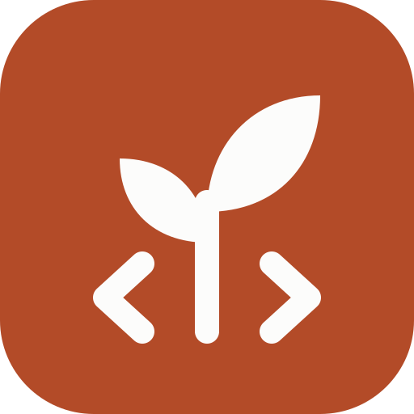

<p align="center"></p>

# CodeBud

CodeBud 是面向**大学生与想学基础程序设计的初学者**的个人学习助手。你可以学习内置课程，也可以导入自己的教材，通过 AI 助教梳理问题、安排学习计划，并把记忆、笔记与任务留在同一个学习空间。

核心编程学习功能离线可用；AI 助教是可选功能，由用户配置自己的服务与 API Key。

**[下载 Windows 安装包（最新版）](https://github.com/zz-zane/CodeBud/releases/latest)** · **[54 秒宣传影片](https://github.com/zz-zane/CodeBud/releases/download/v0.1.1/codebud-promo.mp4)** · **[发布说明](https://github.com/zz-zane/CodeBud/releases/latest)**

安装包命名形如 `CodeBud-0.2.0-setup.exe`，安装后的可执行文件为 `CodeBud.exe`。从 0.1.1 升级：请手动下载安装一次 0.2.0，安装程序会保留原有学习数据；之后的版本会自动更新。

## 功能

| 模块 | 内容 |
|---|---|
| 编程与算法课程 | C / C++ / Java / Python 与算法课程，配套练习、代码示例与可重放的课文演示 |
| 讲解视频 | 遇到抽象概念可生成带旁白的讲解动画，代码在本机真跑核对，可离线重看（需要配置 AI）；课文已有的演示可直接播放 |
| 本机运行 | 使用真实编译器或解释器编译、执行代码，查看输出与报错 |
| 练习、掌握度与错题本 | 多种题型、代码练习、收藏、掌握度标记、错题归集与回顾 |
| 间隔重复复习 | 按学习时间和练习记录安排复习，可在日常长期与考前冲刺两种复习策略间切换，今天页汇总学习任务 |
| 四六级真题 | 内置 58 套四级 + 52 套六级试卷，支持真题练习、词汇学习、本地听力资源，以及 AI 作文／翻译估分（仅供参考） |
| 手机连接 | 同一局域网内，通过配对在手机浏览器学习电脑上的资料，共用进度 |
| AI 助教（可选） | 配置自己的 AI 服务后获得讲解、代码答疑、学习计划安排与记忆管理 |
| 自动更新 | 后台自动检查并下载新版本，重启后生效，可在设置页关闭 |

代码运行依赖电脑上可用的 GCC / G++ / JDK / Python 环境，设置页提供环境检测。手机访问需要电脑保持开启；手机端开放学习与 AI 相关白名单能力，运行本机代码、导入教材和管理 ACP 连接等操作留在电脑端。

## 你的个人学习助手

- **主聊天与专题对话**：在 AI 助教主聊天中持续讨论学习安排，也可以为某个问题创建独立专题，保留各自的对话记录。主聊天可以整理记忆、笔记和教材计划；专题侧重讨论，不能修改这些学习空间资料。
- **结合学习情况回答**：对话可参考当前课程、已学数量、错题薄弱课程，以及附带的代码或报错。它使用应用内已有记录作为参考，完成课程的数量不等于能力测评。
- **用自己的教材安排学习**：导入 UTF-8 TXT / Markdown 或文字型 PDF，填写目标后，让已连接的 AI 生成带教材节选引用的学习计划草稿，由你确认后才写入任务列表生效。长教材使用有限节选，不代表模型逐页读完；扫描 PDF 需先自行 OCR。单份教材上限 25MB，PDF 上限 1200 页。
- **可管理的长期记忆**：保存学习偏好与需要长期保留的信息，每条记忆标明来源（哪门课程或哪次对话），并拒绝保存「完全掌握」这类绝对化结论；可查看、编辑和删除。记忆保存在本机，发送时选取有限内容作为上下文，不是无限聊天记忆。
- **知识库笔记与任务**：保存 Markdown / HTML 笔记、查看隔离的 HTML 预览，并导出独立笔记文件；计划任务可标记为待办、进行中或完成，并在确认后进入日常学习计划。当前没有日历定时提醒，也没有 Obsidian 双向同步。对话只选取有限的相关笔记摘要，不会默认读入整个知识库。
- **讲解视频与课文演示**：课文自带的概念演示可离线直接播放；提问生成新的讲解视频需要先配置可用的 AI 服务，生成过程中的示例程序会在本机真实编译运行核对输出，完成后可搭配系统语音旁白离线重看。
- **四六级作文／翻译 AI 估分与考前冲刺**：提交四级或六级真题 Part I 写作或 Part IV 翻译后，可调用已连接的 AI 给出参考分值与点评（仅供参考，不替代正式阅卷）；设置页可切换为考前冲刺复习策略，并结合课程掌握度聚焦薄弱项。
- **自动更新**：Windows 安装版支持在后台检查、下载新版本并提醒重启安装，升级时保留安装目录下的 `data/` 学习资料；可在「设置 → 关于与更新」随时关闭自动更新或手动检查。
- **计算与绘图**：提供受限数值、矩阵计算及常用绘图入口，需要本机另有 Node.js 和 GNU Octave。未安装时会提示缺少运行环境；不是随包自带完整 MATLAB，也不执行任意系统命令。
- **自带模型**：可以配置 API 服务与自己的 API Key，也可以连接已安装、已登录的 ACP 兼容客户端／适配器。CodeBud 不附送模型账号、订阅或额度；ACP 连接可用性取决于适配器与账号状态。

使用在线模型时，你发送的问题及本次选用的学习上下文会交给所选服务处理。AI 回答和生成计划需要联网及可用模型；本地课程、笔记和学习记录不以购买 AI 服务为前提。

## 安装与学习资料

下载安装包后启动 CodeBud，先在设置中检查运行环境，再打开课程或练习页。

四级与六级听力音频均不包含在安装包中。四级听力音频请从 [四级听力音频 release](https://github.com/zz-zane/CodeBud/releases/tag/cet4-audio-v1) 下载并解压；六级听力音频请从 [六级听力音频 release](https://github.com/zz-zane/CodeBud/releases/tag/cet6-audio-v1) 下载 `cet6-listening-audio.zip` 并解压，然后在 CodeBud 的「四六级真题」页面切换对应等级并选择解压后的音频文件夹。文件夹内按试卷套数分有子目录；共用音频已放入对应套卷目录。

学习记录默认保存在**实际可执行文件旁的 `data/`**。便携启动器使用其所在目录的 `data/`；显式设置 `MIAI_DATA_DIR` 时使用该目录。请定期备份，升级或更换安装目录时保留原有 `data/`。本次改名保持原 appId 与数据路径算法，不自动移动、重置或删除旧资料。

## 本地开发

需要 Node.js、npm，以及验证相应语言代码时所需的本机编译器。

```sh
npm ci
npm run build:content
npm run dev
```

内部 npm 包名仍为 `miai-biancheng`。`window.miai`、IPC 通道、`miai-cet4://` / `miai-cet6://` / `miai-study://` 协议和 `MIAI_*` 环境变量是兼容性接口，不随展示品牌变更。

```sh
npm run typecheck
npm test
npm run validate:content
npm run gen:notices
npm run package:win
```

安装包输出在 `release/`。界面使用系统字体，不再加载或分发 Anthropic Serif。详细规则见 [架构与扩展指南](docs/28-架构与扩展指南.md)。

## 项目结构

| 目录 | 用途 |
|---|---|
| `content/` | 课程、题目、算法资料与四级 58 套、六级 52 套真题 |
| `src/main/` | Electron 生命周期、功能注册、本机存储与代码运行 |
| `src/shared/` | 共享类型、IPC 契约与纯逻辑 |
| `src/preload/` | 桌面能力的受限桥接 |
| `src/renderer/` | Vue 界面、学习页面与状态管理 |
| `resources/` | CodeBud 打包图示 |
| `scripts/` | 内容构建、校验和第三方声明生成 |
| `docs/` | 设计、开发和功能说明 |

## English summary

**CodeBud** is a personal learning assistant for university students and beginners. Alongside offline C, C++, Java, Python and algorithm courses, it offers a main AI chat and topic conversations, learner context, imported-textbook study plans, editable long-term memory, knowledge notes and tasks. Bring your own API service/key or compatible ACP adapter. Local calculations and plots require Node.js and GNU Octave. It also includes real local code execution, spaced repetition, 58 CET-4 and 52 CET-6 exam sets and paired phone access.

## 许可证与致谢

代码和内容分开授权，完整说明见 [LICENSE-CONTENT.md](LICENSE-CONTENT.md)：

| 范围 | 许可 |
|---|---|
| 源代码 | [MIT](LICENSE) |
| 原创课程、题库与文档 | [CC BY-NC-SA 4.0](LICENSE-CONTENT.md) |
| Hello 算法课程 | CC BY-NC-SA 4.0（上游 krahets/hello-algo） |
| 四六级真题与听力音频 | 不授予许可，版权归原权利人，仅供个人学习备考 |

因为内容带有「非商业」条款，**含内容的完整应用与安装包只能用于非商业用途**；只取用 MIT 代码并自行替换内容时不受此限制。

- [第三方依赖声明](THIRD-PARTY-NOTICES.md)：由 `npm run gen:notices` 从实际安装依赖生成。
- [第三方源码与素材声明](THIRD-PARTY-CODE-NOTICES.md)、[许可证原文](LICENSES/)：随软件保留。
- 界面基于 [Caho1/open-claude-ui](https://github.com/Caho1/open-claude-ui/tree/c1f923ae0051a871941b98a0e2e3183a545e6a85) 的 MIT 代码迁移，见 [来源及组件映射](docs/open-claude-ui-migration.md)。
- 算法课程及其他引入材料请按 [第三方源码声明](THIRD-PARTY-CODE-NOTICES.md) 中的独立授权使用。

新 logo 由项目拥有者提供，原稿保留在 `promo-assets/app-icon/logo.svg`；应用使用其派生图示。
